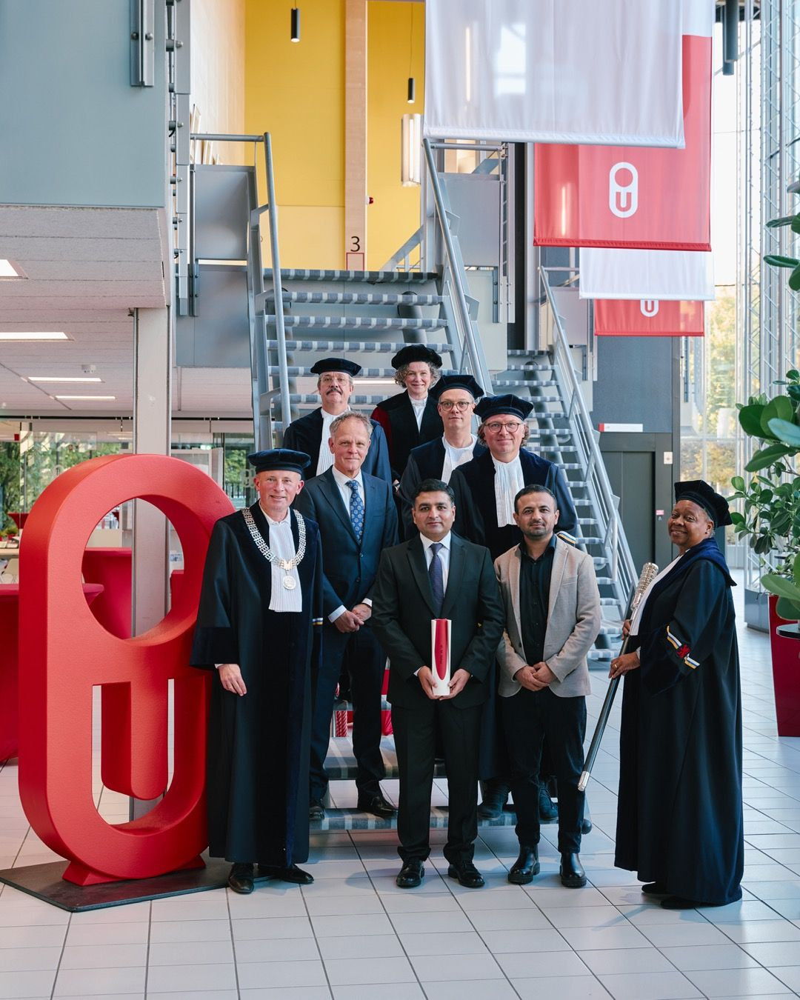

Project title: Computationally Efficient Graph-Based NLP System for Automated Essay Feedback
Institution: Open University of the Netherlands/Maastricht University
Co-supervision by Dr. Peter van Rosmalen (Maastricht University)
Defense date: 30 October 2026

Assessment Committee:
  - Prof. dr. O. De Clercq, Ghent University
  - Prof. dr. L. Kester, Maastricht University
  - Prof. dr. M.M. Specht, FernUniversität Hagen
  - Prof. dr. H.J. Drachsler, Open Universiteit, DIPF/Goethe University Frankfurt 
  - Prof. dr. H.M. Jarodzka, Open Universiteit


